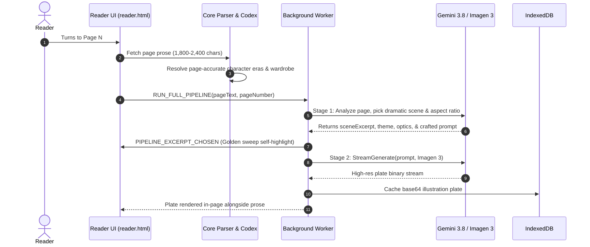

# Erised AI &bull; Fine-Art Literary Reader

<div align="center">


### *An illuminated e-reader that brings contextual character recall, live narrative synthesis, and fine-art book plates to your digital library.*

[](https://github.com/TimothyH3/Erised-AI-Ebook-Reader/actions)
[](LICENSE)
[](manifest.json)
[](package.json)
[](docs/configuration.md)

</div>

---

## Visual Proof


> **In Action**: As you turn pages, Erised AI reads ahead, anchors to prominent dramatic passages with a golden text sweep, resolves page-accurate character wardrobe and age, and illustrates in-page fine-art plates in real-time.

---

## Key Capabilities

| Feature | Description | Engine / Provider |
| :--- | :--- | :--- |
| **In-Page Dual-Flank Plates** | Illustrates prominent scenes and mounts them alongside prose paragraphs with aspect ratios (`16:9`, `4:3`, `3:4`, `1:1`). | Google Imagen 3 / Flux.1 |
| **Zero-Key Headless Mode** | Operates with zero developer API keys and zero token billing by connecting to your active Google consumer session. | Headless Gemini 3.8 + Imagen 3 |
| **Character Codex & Eras** | Tracks multi-era character timelines (aging, wardrobe changes, flashbacks) and substitutes visual descriptions for proper names. | Named Entity Tracking & Substitution |
| **Highlight-to-Plate Studio** | Select any text passage (up to 400 characters) to trigger immediate autonomous synthesis and plate anchoring. | User Selection Anchor Pipeline |
| **Classical Typography** | Classical layout featuring **Cinzel Bold** architectural headers, drop-caps, justified prose, and A- / A+ scaling. | Classical Serif & Cinzel Typography |
| **Format Support** | Lossless layout parsing and semantic page chunking (1,800–2,400 chars) for digital books. | EPUB, PDF, TXT, & Markdown Parsers |
| **Offline Privacy** | Optional local zero-cloud operation with zero telemetry via local models. | Ollama / vLLM (`llama3.2`) |

---

## AI Costs & Prerequisites (Upfront Clarity)

Erised AI is engineered so that **no paid API subscription is required**:

1. **Zero-Key Mode (Default)**: Connects to your active consumer Google session at [gemini.google.com](https://gemini.google.com) with zero developer tokens and zero monthly fees.
2. **Public Fallback Mode**: If signed out of Google, the reader automatically falls back to **Pollinations Flux.1** with a built-in 45-second cooldown rate-limiter.
3. **Local Offline Mode**: Zero cloud telemetry; runs completely on your local GPU via [Ollama](https://ollama.ai) (`llama3.2`).
4. **Direct API Mode (Optional)**: Power users can configure standard Google AI Studio, OpenAI, or Anthropic API keys in `.env`.

---

## Under 3 Minutes Quickstart

### 1. Clone & Setup Environment
```bash
# Clone the repository
git clone https://github.com/TimothyH3/Erised-AI-Ebook-Reader.git
cd Erised-AI-Ebook-Reader

# Copy the environment template
cp .env.example .env

# Install dependencies
npm install
```

### 2. Run Test Suite
```bash
# Executes all 23 unit test suites
npm test
```

### 3. Load Extension in Chrome, Brave, or Edge
1. Open your browser and navigate to `chrome://extensions/`.
2. Enable **Developer mode** (toggle in top right).
3. Click **Load unpacked** and select the `Erised-AI-Ebook-Reader` project root directory.
4. Click the **Erised AI** extension icon or open `src/ui/reader.html` to begin reading.

---

## System Architecture

```
[EPUB / PDF Document] 
       │
       ▼
 [Chunking & AST Extraction] ───────────▶ [Local IndexedDB Cache]
       │                                            │
       ▼                                            ▼
 [Character Codex & Eras] ──────────────▶ [Zero-Name Substitution]
       │                                            │
       ▼                                            ▼
 [Stage 1: Gemini Scene Director] ──────▶ [Stage 2: Imagen 3 Plate Artist]
       │                                            │
       ▼                                            ▼
 [Golden Sweep Prose Anchor] ───────────▶ [In-Page Dual-Flank Plates]
```

### Sequence Flow



See [docs/architecture.svg](assets/architecture.svg) and [docs/api-specs.md](docs/api-specs.md) for complete technical specifications.

---

## Target Directory Architecture

```plaintext
Erised-AI-Ebook-Reader/
├── .github/
│   ├── workflows/             # CI/CD: test pipelines and release packaging
│   │   ├── ci.yml
│   │   └── release.yml
│   └── ISSUE_TEMPLATE/        # Bug reports and feature request templates
│       ├── bug_report.md
│       └── feature_request.md
├── assets/                    # Media strictly for documentation & proof
│   ├── demo.svg               # Reader visual proof hero
│   ├── architecture.svg       # Full architectural diagram
│   └── branding/              # Dark & light logo assets
├── docs/                      # Extended technical documentation
│   ├── api-specs.md           # LLM prompt schemas & background protocols
│   └── configuration.md       # Headless Gemini vs Ollama vs Cloud APIs
├── src/                       # Application Source Tree
│   ├── core/                  # Core parsing logic (EPUB, PDF, text extractors)
│   │   ├── epub-parser.js
│   │   ├── pdf-parser.js
│   │   └── text-extractor.js
│   ├── ai/                    # Prompt pipelines, character dossiers, & providers
│   │   ├── providers/         # Abstracted AI providers (Gemini, Flux, Ollama)
│   │   ├── gemini-headless.js # Headless zero-key session manager
│   │   ├── pollinations-client.js # Flux.1 rate-limited fallback
│   │   ├── prompt-architect.js# Fine-art visual directors & negative filters
│   │   └── character-tracker.js # Multi-era wardrobe tracker & name eliminator
│   ├── storage/               # IndexedDB storage and settings bindings
│   │   └── storage.js
│   └── ui/                    # Frontend presentation components
│       ├── reader.html, reader.js, reader.css
│       ├── popup.html, popup.js, popup.css
│       └── offscreen.html, offscreen.js
├── tests/                     # Unit, integration, and dataset tests
│   ├── fixtures/              # Public-domain sample masterpieces & mock chapters
│   │   ├── sample-books.js
│   │   └── mock-chapters.json
│   └── unit/                  # 23 automated unit test suites
├── scripts/                   # Build and automation utilities
│   ├── run_all_tests.js
│   └── generate_icons.js
├── .env.example               # Sanitized environment template
├── .gitignore                 # Strict ignores: caches, logs, secrets
├── LICENSE                    # Permissive MIT open-source license
├── manifest.json              # Chrome Extension Manifest V3 configuration
└── README.md                  # Front-door documentation
```

---

## Preloaded Masterpieces

Erised AI includes 3 pre-loaded public-domain classics formatted with dedicated Title Pages (zero AI calls on Page 1) and single-page chapter segmentations:

1. **Harry Potter and the Philosopher's Stone** (J.K. Rowling) &mdash; Featuring Chapter I (Privet Drive), Chapter XII (The Mirror of Erised), and Chapter V (Diagon Alley & Ollivanders).
2. **The Magician's Nephew** (C.S. Lewis) &mdash; Featuring Chapter II (Digory & Polly), Chapter V (Wood between the Worlds), and Chapter IX (The Founding of Narnia).
3. **The Hobbit; or, There and Back Again** (J.R.R. Tolkien) &mdash; Featuring Chapter I (An Unexpected Party), Chapter V (Riddles in the Dark), and Chapter XII (Smaug's Lair).

---

## Contributing & Community

Contributions are welcomed! Please follow these steps:
1. Fork the repository and create a feature branch (`git checkout -b feature/amazing-feature`).
2. Ensure all unit tests pass with 100% success (`npm test`).
3. Commit your changes (`git commit -m 'Add amazing feature'`).
4. Push to your branch (`git push origin feature/amazing-feature`) and open a Pull Request.

Please see [.github/ISSUE_TEMPLATE](.github/ISSUE_TEMPLATE) for filing bug reports or feature requests.

---

## License

Distributed under the **MIT License**. See [`LICENSE`](LICENSE) for more information.
